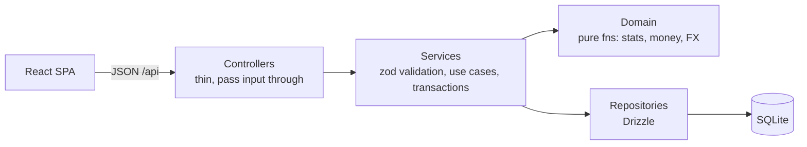

# Architecture & Design Decisions

## Shape
```
salary-manager/
├─ apps/api      NestJS + Drizzle ORM + better-sqlite3
├─ apps/web      React (Vite) + TanStack Query + Mantine
└─ packages/shared  zod schemas, types, country→currency + FX config
```
The whole app ships as **one Docker image**: Nest serves the built React app under `/` and the API under `/api`. The SQLite file sits on a persistent volume (Railway or Fly.io).



## Key decisions
| Decision | Why | Trade-off |
|---|---|---|
| **SQLite** | 10k rows is tiny. There's no server to run, and tests can use `:memory:` with real SQL. | Only one writer at a time. Fine for one HR team. Move to Postgres if there are many concurrent writers. |
| **Drizzle + better-sqlite3** | Typed SQL with no codegen step, and a synchronous driver that keeps tests fast and simple. | Smaller ecosystem than Prisma. |
| **Shared zod schemas** | One place defines validation, used by the API's services and the React forms. The services validate, not a controller pipe, because some rules need the clock and the stored employee ([ADR 004](adr/004-validation-in-the-service-with-shared-zod-schemas.md)). | Couples the two apps to one package (acceptable in a monorepo). |
| **Money as integer minor units + currency** | Floating-point money causes rounding bugs. The currency comes from the country, so it can't be entered inconsistently. | Values must be formatted at the edges. |
| **Countries and FX as versioned config, not a table** | Small, rarely changes, and reviewed in a PR. | Changing it needs a deploy. |
| **Median computed in a pure function** | SQLite has no MEDIAN. Sorting 10k integers takes milliseconds and the function is easy to unit-test. | At around 1M rows: precompute or use window functions. |
| **Salary change + history in one transaction** | History must never drift from the current salary. | None worth noting. |
| **Single deployable** | One URL, no CORS, cheapest to host. | Web and API can't scale separately (not needed). |

## Data model
- `employees(id, full_name, email UNIQUE, job_title, department, country_code, currency, salary_minor INT, employment_type, hire_date, created_at, updated_at)`
- `salary_changes(id, employee_id FK ON DELETE CASCADE, old_salary_minor INT NULL, old_currency NULL, new_salary_minor INT, currency, effective_date, reason, created_at)`
  - `old_salary_minor` and `old_currency` are null on the "Starting salary" row. On a normal change `old_currency` equals `currency`. On a country change it is the previous currency, so the old value is never read in the wrong currency.
- Indexes on `employees`: `(country_code, job_title)`, `(department)`, `(full_name COLLATE NOCASE)`, `(email)` unique. The name index carries the collation because the directory sorts names ignoring case, and SQLite only uses an index whose collation matches the ORDER BY.
- Index on `salary_changes`: `(employee_id)`, for the history lookup on the employee page.

## API
| Method | Path | Purpose |
|---|---|---|
| GET | `/api/employees?search&country&department&jobTitle&sort&page&pageSize` | Directory |
| GET | `/api/employees/export.csv?…same filters` | CSV export |
| GET | `/api/employees/:id` | Detail + salary history + the median for the same job title and country |
| POST | `/api/employees` | Create |
| PATCH | `/api/employees/:id` | Update details. Never salary, unless the country changes: then `newSalaryMajor` and `reason` are required |
| POST | `/api/employees/:id/salary-changes` | Change salary (`newSalaryMajor`, `effectiveDate`, `reason`) and record it in history |
| DELETE | `/api/employees/:id` | Remove |
| GET | `/api/insights/summary` | Headcount and USD payroll |
| GET | `/api/insights/countries` | Stats per country |
| GET | `/api/insights/countries/:code/job-titles` | Stats per role, with outliers |
| GET | `/api/meta` | Countries, departments and titles for the filters |
| POST | `/api/simulations/raise` | Raise simulator: cost per country in local currency + indicative USD total (read-only, nothing saved) |
| GET | `/api/docs` | API docs (Swagger) |
| GET | `/health` | Health check |

## Product rules
- A salary change's effective date **cannot be in the future**. The change applies immediately.
- Salary is **not** editable in "Edit details". It only changes through "Change salary", so every change has a reason.
- Changing an employee's **country** requires a new salary in the new currency, and that is recorded in the history.
- Creating an employee writes the first history entry ("Starting salary").

## Testing strategy
- **Domain unit tests (most of the suite):** stats (median of even/odd/empty sets), money formatting, FX conversion, outlier rule, zod schemas.
- **Service tests on in-memory SQLite:** real SQL, still runs in milliseconds, nothing mocked. Mocking repositories would test the mocks rather than the queries.
- **A few API e2e tests** with supertest against the Nest app.
- **Web:** Vitest + Testing Library for the employee form validation and the filter → query wiring.
- **Determinism:** seeded faker, an injected clock, and a fresh DB for every test.

## Performance notes (fill in with measured numbers)
- Seed: 10k inserts in one transaction with a prepared statement. Target < 1 s. **Measured: 219 ms and 256 ms** for 10,000 employees plus 14,976 salary-history rows (two runs of `npm run seed` to a file on a local SSD, Node 26, Windows 11, 2026-11-19).
- Directory query with filters and pagination: target < 50 ms server time. **Measured: 3.0 ms** for the default page and **5.1 ms** with search + country filter + salary sort (median of 15 requests).
- Insights: one slim query, then count/min/median/avg/max in memory with the pure `summarize` function (no SQL GROUP BY: it was not needed). Target < 100 ms. **Measured: summary 9.7 ms, countries 9.9 ms, India's job titles and outliers 7.1 ms** (median of 15 requests; the slowest single request was 27 ms).
- Employee detail with role median: **2.0 ms**.
- CSV export of all 10,000 employees (1.13 MB, streamed in batches of 1,000): **133 ms** median, 146 ms slowest of 15 runs.
- All timings are full HTTP round trips with curl to the built API on localhost, against the 10,000-employee seed in a SQLite file (Node 26, Windows 11, 2026-11-19). They are a single-user check; the load test is in the next section.

## Load test (measured)
`npm run load-test` (`scripts/load-test.js`) starts the built API on a throwaway database with the 10,000-employee seed and runs autocannon against each endpoint in turn. Measured on 2026-11-20 with 10 concurrent connections for 10 seconds per endpoint, API and load generator on the same laptop (Node 26.13.1, Windows 11, 12 logical CPUs). No request failed. p50, p95 and p99 are computed from every response time, because autocannon does not report p95.

| Endpoint | Requests/s | p50 (ms) | p95 (ms) | p99 (ms) | Max (ms) |
|---|---|---|---|---|---|
| Directory: default page | 2713 | 3.5 | 4.7 | 5.7 | 23.7 |
| Directory: search + country + salary sort | 293 | 33.4 | 38.3 | 41.4 | 67.0 |
| Directory: last page (page 400) | 1833 | 5.2 | 6.8 | 8.3 | 16.1 |
| Directory: 100 rows per page | 1940 | 4.9 | 6.3 | 7.7 | 17.3 |
| Insights: summary | 118 | 82.4 | 93.4 | 100.6 | 164.2 |
| Insights: countries | 114 | 86.0 | 96.1 | 117.3 | 169.4 |
| Insights: India job titles + outliers | 177 | 55.6 | 61.5 | 80.6 | 111.9 |

What the numbers say:
- **The directory target (p95 < 300 ms) holds under this load.** The slowest case measured is search + country + salary sort at 38.3 ms.
- **Throughput is set by how long one request takes, because requests run one at a time.** better-sqlite3 is synchronous, so a request holds the event loop from query to JSON. Requests per second is about 1 / (time for one request), and latency is about that time multiplied by the number of connections. More connections add waiting, not throughput.
- **The first run of this test found a missing index, now fixed.** The name index was on plain `full_name`, but the directory sorts with `COLLATE NOCASE`, so `EXPLAIN QUERY PLAN` showed `SCAN employees` + `USE TEMP B-TREE FOR ORDER BY`: a full sort of 10,000 rows on every request. Migration `0001_name_index_ignores_case` rebuilt the index with the collation and the plan became `SCAN employees USING INDEX employees_full_name_idx`. A test asserts that plan.

  | Last page (page 400), name order | Requests/s | p50 (ms) | p95 (ms) | p99 (ms) |
  |---|---|---|---|---|
  | Before (plain index) | 85 | 115.9 | 130.0 | 137.1 |
  | After (`COLLATE NOCASE` index) | 1833 | 5.2 | 6.8 | 8.3 |

  The default page improved too, from 787 to 2,713 requests per second, because it no longer sorts either. A deep page still walks the index to its offset (1,833 against 2,713 requests per second); keyset pagination would remove that if it ever matters.
- **Search with a filter and a salary sort is now the slowest directory request** (293 requests per second). A `LIKE '%text%'` search cannot use an index, and the matches are then sorted by salary; its query plan has not been examined yet.
- The single-request timings in the performance notes above were taken before this index change; the directory figures there are now pessimistic.
- **Each insights request reads every employee and computes in memory**, about 9 ms of blocking work, so about 110 requests per second. That is far more than one HR team produces, and it is the first thing to move into SQL or precompute as the data grows.
- The cost model and the exits are in [ADR 001](adr/001-sqlite-and-single-deployable.md).
